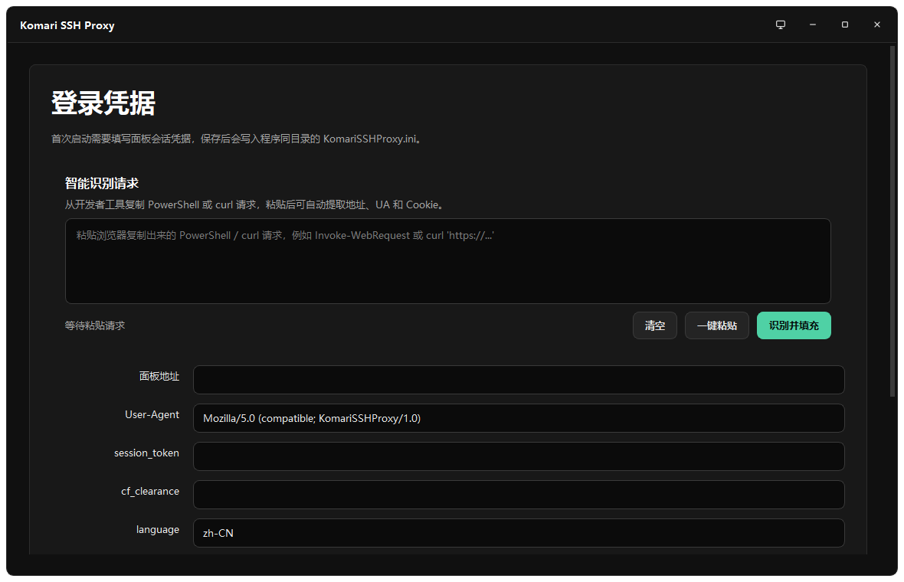
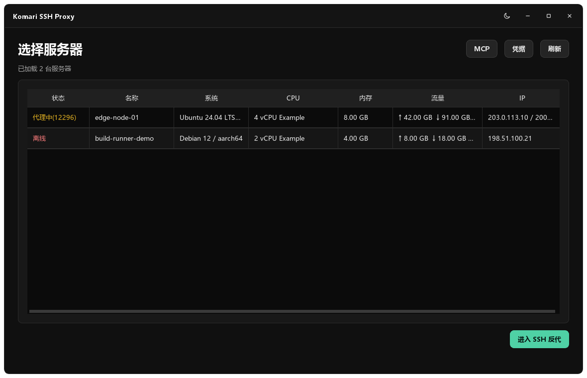
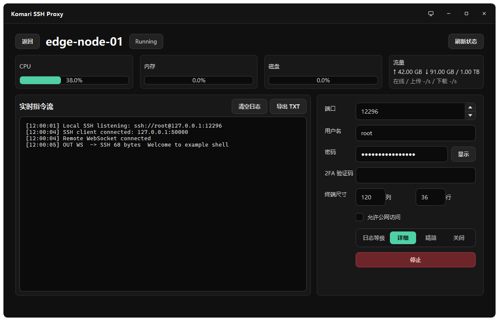
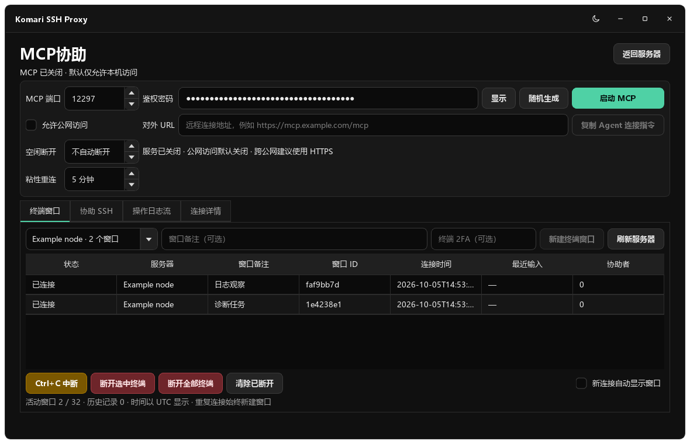

# Komari SSH Proxy

Komari SSH Proxy 是一个 SSH 代理工具，用于把 Komari 面板的网页终端 WebSocket 桥接成标准 SSH 端口，而不必依赖网页终端。

> 仅用于你拥有或已获授权管理的 Komari 面板和节点。



## 功能

- 支持从浏览器开发者控制台复制出的请求中智能所需凭据。
- 显示在线状态、CPU、内存、磁盘、流量、IP 和代理状态。
- 支持多台服务器同时开启本地 SSH 代理
- 实时指令流支持清空和导出 TXT。
- 可选允许公网访问
- 提供带独立密码鉴权的 MCP 交互终端桥，兼容无法使用 SSH `exec` 的 Agent。
- MCP 支持独立多窗口、显式回车、Ctrl+C 等按键、输出游标、连接详情和可导出的操作日志。
- 协助模式可将选中的 AI 终端共享为本机 SSH，支持用户实时监看与共同输入。
- 支持 SFTP：本地 SSH 代理端口与协助端口都可直接使用 `sftp` / `scp` 传输节点文件。
- 支持粘性会话：MCP 终端与本地 SSH 反代在远端短暂掉线后都会自动重连并重挂原终端，界面显示“重连中”。

## 界面







截图中的服务器名、IP 和日志均为示例数据。

## 从源码运行

推荐 Python 3.12 或更新版本。

```powershell
python -m venv .venv
.\.venv\Scripts\Activate.ps1
python -m pip install --upgrade pip
python -m pip install -r requirements.txt
python main.py
```

## 配置文件

程序首次打开时，会在脚本或 exe 同目录生成 `KomariSSHProxy.ini`。

字段说明：

- `base_url`：Komari 面板地址，例如 `https://komari.example.com`
- `user_agent`：请求面板接口时使用的浏览器 User-Agent
- `session_token`：面板登录会话 Cookie
- `cf_clearance`：Cloudflare 放行 Cookie，如面板站点需要则填写
- `sensorsdata2015jssdkcross`：面板浏览器环境中的可选 Cookie
- `language`：语言 Cookie，默认 `zh-CN`
- `extra_cookies`：额外 Cookie，格式为 `a=b; c=d`
- `ssh_password`：默认本地 SSH 登录密码，首次运行生成，用户修改后更新
- `ssh_host_key_pem`：本地 SSH 服务端 Host Key，首次运行生成
- `app_theme`：`system`、`dark` 或 `light`

端口、用户名、公网访问、终端尺寸、2FA 验证码仍是运行时配置，不会写入 ini。


## 智能识别

登录页支持直接粘贴浏览器开发者工具复制出来的请求：

- PowerShell `Invoke-WebRequest`
- curl 命令

点击识别后，程序会尝试提取面板地址、User-Agent 和已知 Cookie 字段。

## 本地 SSH 代理

默认运行时设置：

- 端口：`12296`
- 用户名：`root`
- 密码：首次启动生成并持久化到 `KomariSSHProxy.ini`
- 监听地址：`127.0.0.1`
- 允许公网访问：关闭
- 终端尺寸：`120` 列、`36` 行

开启“允许公网访问”后，本地 SSH 服务会监听 `0.0.0.0`。开启前请确认密码强度和防火墙规则。

